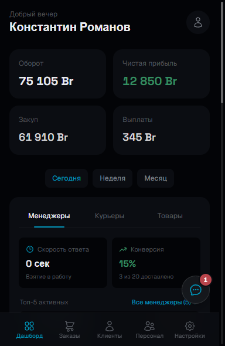
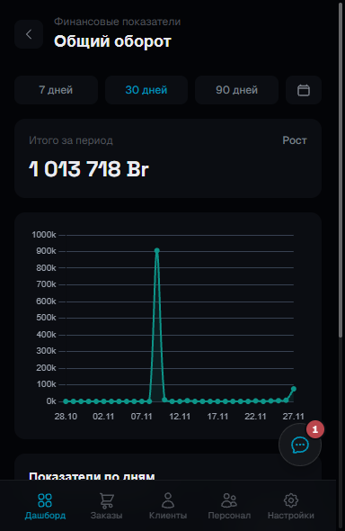
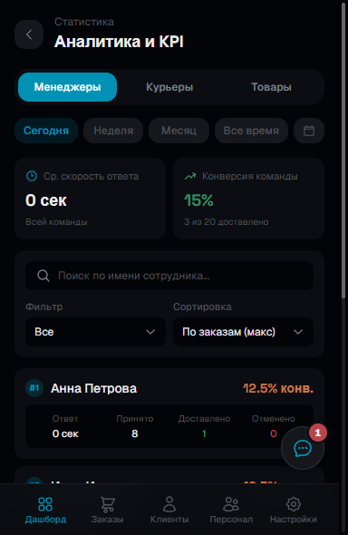
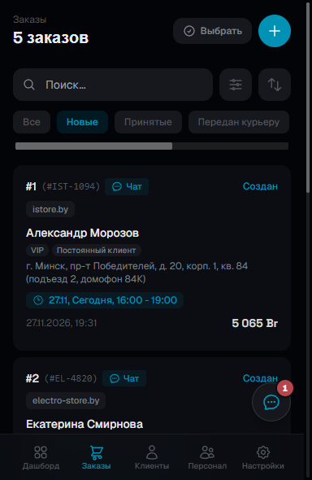
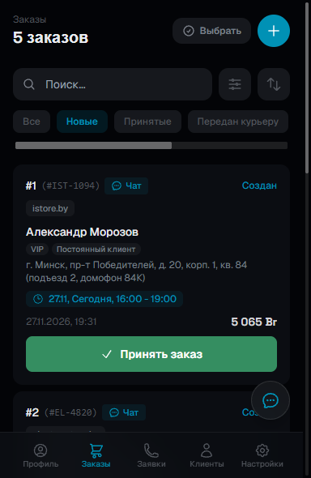
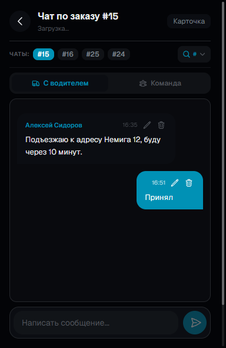
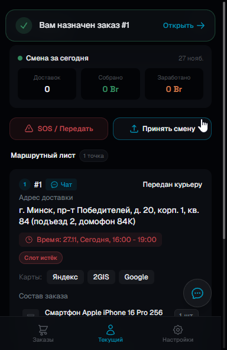
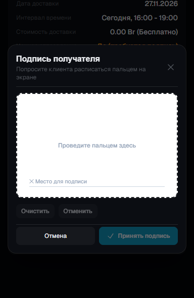

# Enclave CRM

Self-hosted CRM и бэкенд для управления заказами и курьерской доставкой через Telegram Mini App (TMA). 

Авторизация построена на валидации `initData` по белому списку Telegram ID без логинов и паролей. Предусмотрены инструменты экстренной изоляции (сброс сессий в один клик) и очистки данных по расписанию.

[](LICENSE)
[](https://php.net)
[](https://laravel.com)
[](https://core.telegram.org/bots/webapps)
[](docker-compose.yml)

---

## Скриншоты интерфейса

Интерфейс спроектирован для Telegram Mini App с адаптивной версткой под мобильные устройства и десктопный клиент Telegram.

### 1. Интерфейс владельца (Owner)

Контроль ключевых финансовых показателей бизнеса, мониторинг динамики выручки, аудит заказов и KPI персонала.

| Главный дашборд | Динамика оборота |
| :---: | :---: |
| <br><sub>Сводка: оборот, прибыль, закуп, выплаты курьерам и конверсия</sub> | <br><sub>Интерактивный график оборота с фильтрами за 7, 30 и 90 дней</sub> |

| Аналитика и KPI | Реестр заказов |
| :---: | :---: |
| <br><sub>Статистика команды: скорость ответа, конверсия и число доставок</sub> | <br><sub>Сквозной список заказов с фильтрацией по статусам и магазинам</sub> |

### 2. Интерфейс менеджера (Manager)

Обработка входящих заказов, распределение доставок и коммуникация с курьерами в реальном времени.

| Прием заказов в работу | Real-time чат по заказу |
| :---: | :---: |
| <br><sub>Быстрый прием заказов в работу и распределение по курьерам</sub> | <br><sub>Раздельные каналы связи: диалог с водителем и внутренний чат команды</sub> |

### 3. Рабочее место курьера (Courier)

Мобильный интерфейс для выездной доставки: маршрутный лист, навигация и подтверждение вручения.

| Смена и маршрутный лист | Электронная подпись (Signature Pad) |
| :---: | :---: |
| <br><sub>Смена, собранная касса, маршрутный лист и переход в Яндекс.Карты, 2GIS, Google Maps</sub> | <br><sub>Модальное окно цифровой подписи клиента прямо на экране смартфона</sub> |

---

## Архитектура и возможности

### Роли сотрудников
- **Owner (Владелец):** Финансовые показатели (оборот, себестоимость, чистая прибыль, выплаты), аудит действий (`ActionLog`), генерация и безопасная ротация API-токенов сайтов, управление доступом через инвайты Telegram, экстренная очистка (Emergency Wipe).
- **Manager (Менеджер / Оператор):** Прием заказов из Telegram и интернет-магазинов в один клик, распределение по курьерам (`bulk-assign`), командный real-time чат по заказу, обработка входящих лидов с сайтов, управление каталогом товаров с вариантами и базой клиентов.
- **Courier (Курьер):** Мобильный дашборд доставок, смена статусов, адресная навигация, электронная подпись клиента на экране (Signature Pad) и фотоподтверждение доставки, командный чат по заказу, подсчет кассы и заработка за смену, безопасная форс-мажорная передача заказов другому курьеру (SOS) со сверкой наличных и кодом подтверждения.

### Безопасность
- **Беспарольный вход:** Проверка криптографической подписи Telegram `initData` по белому списку идентификаторов.
- **Сессии и GeoIP:** Хранение токенов в Redis, мониторинг подозрительных входов по IP. Блокировка сотрудника сбрасывает токен и выбивает сессию клиента по WebSocket через Reverb.
- **Антифрод и защита интеграций:** Honeypot-ловушки, детекция ботов и временных email, SHA-256 хеширование токенов витрин с защитой от pass-the-hash, многоуровневый Rate Limiting.
- **Data Retention:** Автоматическая архивация суммарной финансовой статистики и удаление сырых логов/заказов старше $N$ дней.
- **Emergency Wipe:** Скрипт экстренного удаления базы данных, кэша и логов с подтверждением через PIN-код владельца.

---

## Стек технологий

- **Backend:** PHP 8.5, Laravel 13
- **Бот и Telegram API:** Nutgram 4
- **Real-time:** Laravel Reverb (WebSockets)
- **База данных:** PostgreSQL 17
- **Кэш и очереди:** Redis, Laravel Horizon
- **Интерфейс TMA:** Blade, Tailwind CSS, Alpine.js, Chart.js, Wayfinder
- **Инфраструктура:** Docker Compose, Nginx FastCGI

---

## Быстрый запуск

### Требования
- Docker и Docker Compose v2+
- Зарегистрированный бот в [@BotFather](https://t.me/BotFather)
- Домен с HTTPS (требование Telegram WebApp для загрузки Mini App)

### 1. Клонирование и конфигурация
```bash
git clone https://github.com/aidsoul/enclave-crm.git
cd enclave-crm
cp .env.example .env
```

Заполните переменные окружения в `.env`:
- `TELEGRAM_BOT_TOKEN` — токен бота от [@BotFather](https://t.me/BotFather).
- `TELEGRAM_BOT_USERNAME` — юзернейм бота без `@`.
- `TELEGRAM_WEBHOOK_URL` — базовый HTTPS URL приложения или полный URL вебхука бота (`https://crm.example.com/api/telegram/webhook`).
- `TELEGRAM_WEBHOOK_SECRET_TOKEN` — секретный ключ для верификации запросов вебхука от Telegram (1–256 символов `A-Z, a-z, 0-9, _ -`).
- `TELEGRAM_WEB_APP_URL` — HTTPS URL для Telegram Mini App (например, `https://crm.example.com/app`).
- `APP_URL` — публичный HTTPS URL приложения (`https://crm.example.com`).
- `REVERB_APP_KEY`, `REVERB_APP_SECRET`, `REVERB_HOST`, `REVERB_PORT` — параметры для WebSocket-соединения.

### 2. Сборка и запуск контейнеров
```bash
docker compose up -d --build
```

### 3. Инициализация приложения
Выполните миграции, генерацию ключа приложения и сборку фронтенда:
```bash
# Генерация ключа приложения
docker exec crm_app php artisan key:generate

# Запуск миграций базы данных
docker exec crm_app php artisan migrate --force

# Установка webhook для Telegram бота (с верификацией секретного токена)
docker exec crm_app php artisan telegram:set-webhook

# Проверить статус вебхука в Telegram API:
# docker exec crm_app php artisan telegram:check-webhook
```

### 4. Регистрация первого владельца (Owner)
При первом запуске зарегистрируйте Telegram ID первого владельца в белом списке:
```bash
docker exec crm_app php artisan user:create --telegram-id=<YOUR_TELEGRAM_ID> --role=owner --name="Owner"
```

После этого откройте бота в Telegram и запустите Mini App по кнопке Menu или команде `/start`.

---

## Интеграция и API

Enclave CRM поддерживает прием заказов от внешних интернет-магазинов и посадочных страниц через REST API (`POST /api/orders/incoming`) с валидацией, защитой от дублей и асинхронной обработкой через очереди.

Подробная спецификация эндпоинтов, описание всех поддерживаемых полей и примеры интеграции доступны в руководствах:
- **[Интерактивная документация OpenAPI / Swagger](http://localhost:8080/docs/api)** (спецификация: [`docs/api/openapi.yaml`](docs/api/openapi.yaml))
- **[Документация API входящих заказов](docs/api/incoming-orders.md)**
- **[Документация API входящих заявок (лидов)](docs/api/incoming-leads.md)**
- **[Документация API каталога товаров и вариантов](docs/api/catalog-sync.md)**

Также ознакомьтесь с [журналом изменений (Changelog)](CHANGELOG.md) и [руководством по разработке](CONTRIBUTING.md).

---

## Фоновые процессы и сервисы

В Docker Compose настроены следующие сервисы:
- **crm_app:** Основное PHP-FPM приложение
- **crm_nginx:** Web-сервер и маршрутизация статики
- **crm_postgres:** База данных PostgreSQL 17
- **crm_redis:** Быстрый кэш и сессии
- **crm_queue:** Обработчик очередей (`queue:work`)
- **crm_reverb:** WebSocket-сервер для мгновенного обновления заказов и статусов
- **crm_scheduler:** Планировщик периодических задач (`schedule:run`)
- **crm_node:** Сборщик фронтенд-ассетов (`npm run dev` / Vite)

---

## Тестирование

Запуск тестов в контейнере:
```bash
docker exec crm_app php artisan test
```

Проверка статического анализа:
```bash
docker exec crm_app ./vendor/bin/phpstan analyse
```

---

## Лицензия

Проект распространяется под лицензией **GNU Affero General Public License v3 (AGPL-3.0)** с дополнительными условиями в соответствии с Section 7:
- Обязательное сохранение карточки и ссылки на автора (AidSoul) в меню/настройках интерфейса.
- Ограничение на несанкционированное использование товарного знака «Enclave CRM».

Подробный текст лицензии доступен в файле [LICENSE](LICENSE).
